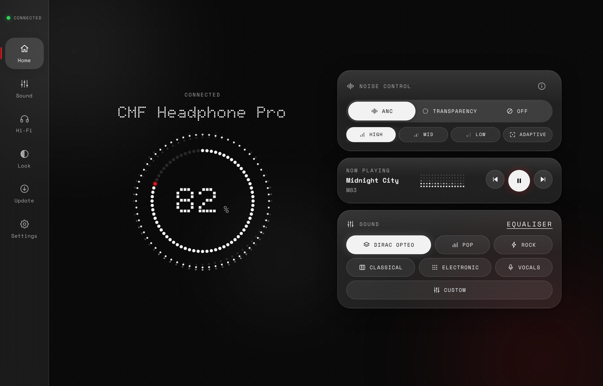
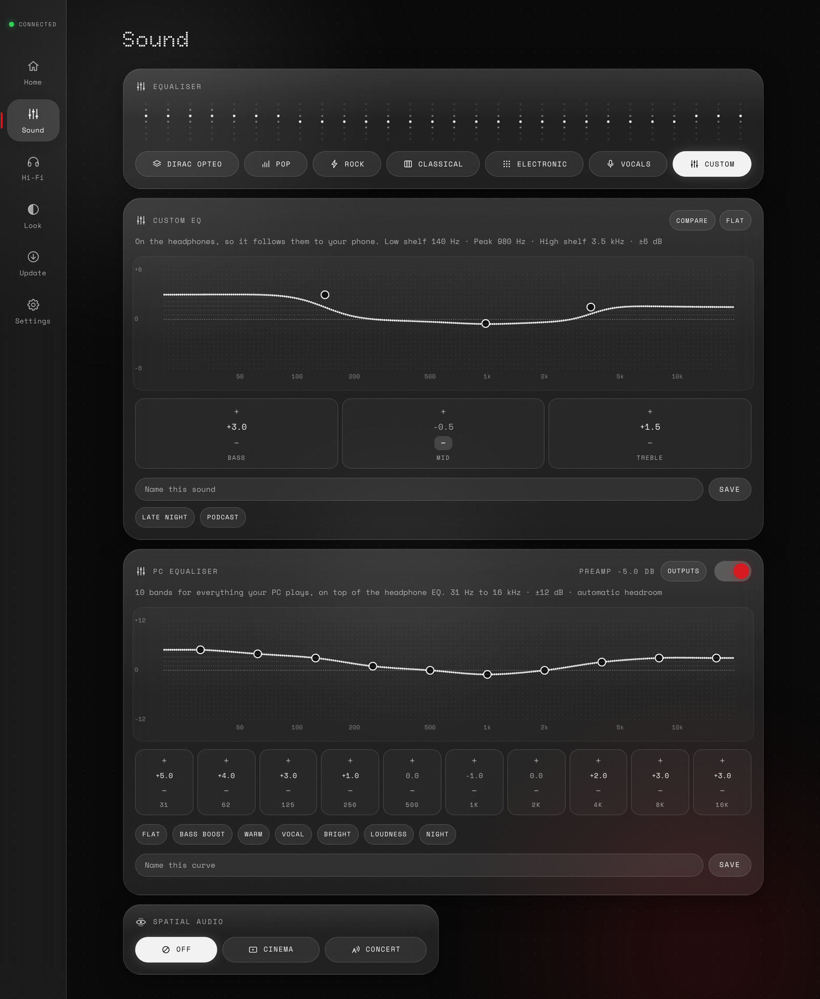
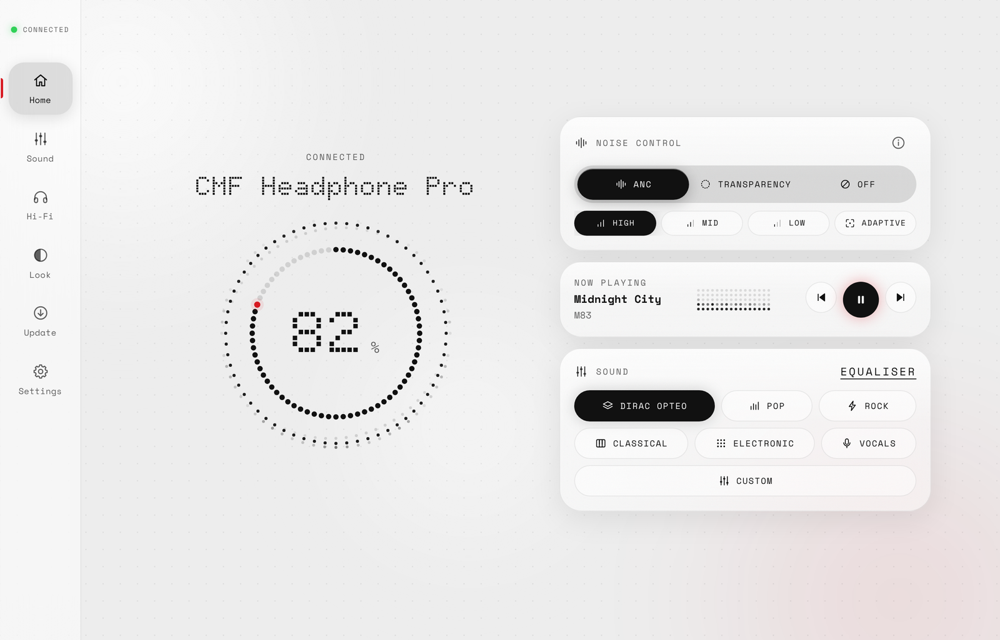
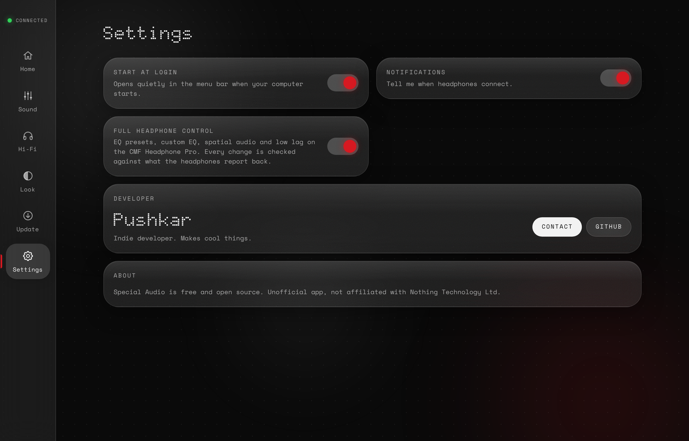

# Special Audio

A desktop app for **every sound device** on Windows and Mac: headphones, earbuds, speakers, wired, USB and built-in outputs, plus any other Bluetooth device. Battery, every device detail, a 10-band system EQ and a live visualizer for all of them. Devices that speak the Nothing protocol also get noise control, on-device EQ, spatial audio, low lag and button controls. No account, no sign-in.

Made by **Pushkar**, an indie developer who makes cool things.

> Unofficial. Not affiliated with Nothing Technology Ltd.



<table>
  <tr>
    <td width="50%"></td>
    <td width="50%"><br><br></td>
  </tr>
  <tr>
    <td align="center"><b>Sound</b>: presets, custom EQ, PC equaliser, spatial audio</td>
    <td align="center"><b>Light mode</b> and <b>Settings</b></td>
  </tr>
</table>

## Download

| | |
|---|---|
| **Windows 10 / 11** | **[⬇ Download for Windows](https://github.com/PushkarX-Code/Special_audio/releases/latest/download/Special-Audio-windows-setup.exe)** |
| **Mac** (Apple Silicon and Intel) | **[⬇ Download for Mac](https://github.com/PushkarX-Code/Special_audio/releases/latest/download/Special-Audio-mac.dmg)** |

All versions: [Releases page](https://github.com/PushkarX-Code/Special_audio/releases)

### The first time you open it, your computer will warn you. This is expected.

Special Audio is a free, independent app. It isn't signed with a paid Apple or Microsoft developer certificate, so your computer says it doesn't know who made it. You only have to approve it once.

**Windows**
1. Open the file you downloaded (`Special-Audio-windows-setup.exe`).
2. A blue window says **"Windows protected your PC"**. Click **More info**, then **Run anyway**.
3. Click through the installer. Special Audio opens and is in your Start menu.

**Mac**
1. Open the file you downloaded (`Special-Audio-mac.dmg`) and drag **Special Audio** onto the **Applications** folder.
2. Open **Special Audio** from Applications. macOS says it **"could not verify"** the app. Click **Done**.
3. Open **System Settings → Privacy & Security**, scroll down to **"Special Audio was blocked"** and click **Open Anyway**. Enter your Mac password and click **Open**.
4. Still not opening, or macOS says the app is **"damaged"**? Open the **Terminal** app, paste this line, press Enter, then open Special Audio again:
   ```
   xattr -cr "/Applications/Special Audio.app"
   ```

### Or install with one command and skip the warning

This downloads, installs and opens the newest version for you. Run it again any time to update.

**Mac**: open **Terminal** (press `⌘ Space`, type *Terminal*, press Enter), paste this line and press Enter:
```
curl -fsSL https://raw.githubusercontent.com/PushkarX-Code/Special_audio/main/scripts/install-mac.sh | bash
```

**Windows**: open **PowerShell** (press the Windows key, type *PowerShell*, press Enter), paste this line and press Enter:
```
irm https://raw.githubusercontent.com/PushkarX-Code/Special_audio/main/scripts/install-windows.ps1 | iex
```

There's no warning because the warning only appears for files downloaded through a web browser. You can read exactly what each command does: [Mac script](scripts/install-mac.sh), [Windows script](scripts/install-windows.ps1).

### Is it safe?

- All the code is public in this repository. Nothing is hidden.
- The installers are built by GitHub's own servers from this code, not on someone's computer: see [Actions](https://github.com/PushkarX-Code/Special_audio/actions).
- The app has no account, no sign-in, no tracking and no internet connection. It only talks to your devices.

## What's inside

| Tab | What it does |
|---|---|
| **Home** | Device name, live battery ring, a switch between connected devices, noise control (on devices that have it), music controls, quick sound presets |
| **Sound** | 10-band system EQ for any device, with presets, saved curves and automatic headroom; on devices that have them: EQ presets, custom EQ on the device (drag the curve or set each band in 0.5 dB steps, compare, save presets) and spatial audio |
| **Hi-Fi** | Every detail the computer knows about the device (type, maker, IDs, firmware, profiles, battery per side…); on devices that have them: audio quality (AAC or LDAC), button controls, low lag mode |
| **Update** | Your version, what's new, and one-click updates |
| **Look** | Theme, round or square dots, glass style, full or calm animation, music visualizer |
| **Settings** | Start at login, notifications, full device control, reset all, developer and contact |

It also lives in your **menu bar (Mac) or system tray (Windows)**: click the icon for a mini panel with battery, noise control, sound presets and music controls.

**Updates install from inside the app.** When a new version is out, an update screen shows what's new with an **Update now** button. You can also open the **Update** tab any time.

## What works today

| | Windows | Mac |
|---|---|---|
| Any Bluetooth device (headphones, speakers, mice, keyboards…): name, battery, full details | Yes | Yes |
| Wired, USB, HDMI and built-in outputs: name and details | Yes | Yes |
| System EQ, 10 bands, for everything the computer plays, on any output | Yes, with the free [Equalizer APO](https://sourceforge.net/projects/equalizerapo/) | Yes, built in (macOS 14.2 or later) |
| Visualizer: the ring and music card move with your music | Yes, from the real sound | Yes, from the real sound once System Audio Recording is allowed |
| Music controls: song, play/pause, next, previous | Any music app | Spotify and Apple Music |
| Menu bar / tray panel, start at login, in-app updates, custom looks | Yes | Yes |
| Nothing-protocol devices: noise control, EQ presets, custom EQ, spatial audio, low lag, audio quality, button controls | Yes | Yes |

**System EQ on Mac:** the first time you turn it on, macOS asks to allow System Audio Recording. The sound never leaves your Mac and nothing is recorded; the app only runs the EQ on it.

Close the Nothing X app on your phone before connecting: the headphones accept one controller at a time.

After every change the app asks the headphones what they actually switched to and shows that, so what you see is what's playing.

**System EQ setup (Windows, once):** the Sound tab walks you through it. Install Equalizer APO, tick your devices in the list it shows, restart, then click **Allow** in Special Audio. After that the curve applies to everything your PC plays.

---

<details>
<summary><b>For developers</b></summary>

### Run from source

Needs [Node.js](https://nodejs.org) 20+.

```
npm install
npm start        # web version at http://localhost:5173
npm test         # protocol and safety tests
npm run tauri dev    # desktop window (needs Rust)
```

### Build installers

GitHub builds them: **Actions → Build app → Run workflow**. That publishes a release with the Windows `.exe`/`.msi` and the Mac `.dmg`. Pull requests build the installers too (download them from the run's Artifacts).

### Safety

- Every outgoing command is on a fixed allowlist. Commands documented by two independent sources are always on; commands from one source (EQ, custom EQ, spatial, low lag) can be switched off in Settings → Full device control. Anything else throws before it is sent.
- No firmware, reset or pairing commands exist in the code.
- One command per 150 ms. Every command waits for the device reply, with one retry.
- Raw Bluetooth logs are git-ignored: they contain addresses and serial numbers.
- The Windows visualizer reads the sound level of what's playing ~30 times a second. Nothing is recorded or saved.

### Layout

```
app/                 the interface (plain HTML, CSS, JavaScript, no build step)
  src/protocol/      frame + CRC, confirmed commands, draft commands, allowlist, parser
  src/device/        session (rate limit, retry), controller (state), simulated device for tests
  src/ui/            battery gauge, background, EQ visual, controls, developer panel
src-tauri/           desktop app shell (Tauri), icons, Windows/Mac packaging
docs/                protocol research, screenshots
test/                tests (capture fixtures go in test/fixtures)
tools/               dev server
scripts/             one-command installers for Mac and Windows
.github/workflows/   automatic Windows + Mac builds
```

Protocol research: [docs/protocol-research.md](docs/protocol-research.md). Fonts: Doto and Space Mono, SIL Open Font License (see `app/fonts/`).

</details>
