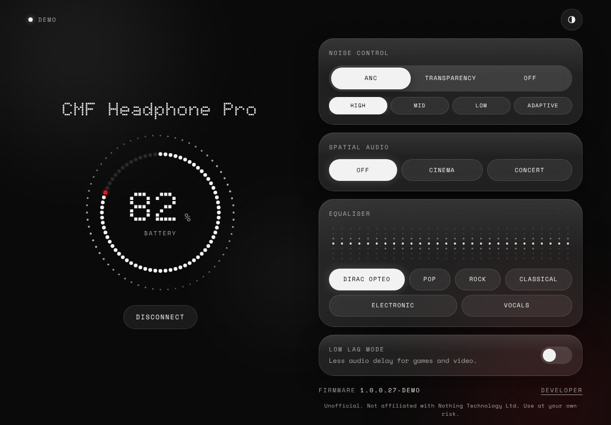
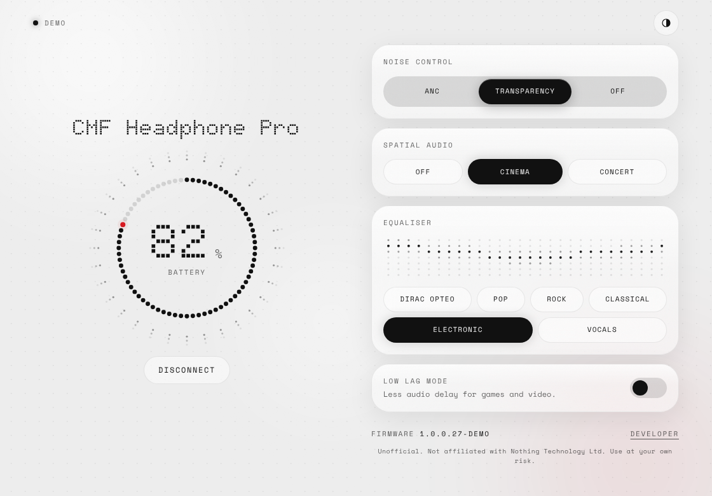

# Special Audio

A desktop app for the **CMF Headphone Pro** on Windows and Mac. Check battery, switch noise control, spatial audio, EQ and Low Lag mode from your computer. No account, no sign-in.

> Unofficial. Not affiliated with Nothing Technology Ltd. Use at your own risk.





## Download

| | |
|---|---|
| **Windows 10 / 11** | **[⬇ Download for Windows](https://github.com/PushkarX-Code/Special_audio/releases/latest/download/Special-Audio-windows-setup.exe)** |
| **Mac** (Apple Silicon and Intel) | **[⬇ Download for Mac](https://github.com/PushkarX-Code/Special_audio/releases/latest/download/Special-Audio-mac.dmg)** |

All versions: [Releases page](https://github.com/PushkarX-Code/Special_audio/releases)

### The first time you open it, your computer will warn you. This is expected.

Special Audio is a free, independent app. It isn't signed with a paid Apple or Microsoft developer certificate, so your computer says it doesn't know who made it. You only have to approve it once.

**Windows**
1. Open the file you downloaded (`Special-Audio-windows-setup.exe`).
2. A blue window says **"Windows protected your PC"**. Click **More info**, then **Run anyway**.
3. Click through the installer. Special Audio opens and is in your Start menu.

**Mac**
1. Open the file you downloaded (`Special-Audio-mac.dmg`) and drag **Special Audio** onto the **Applications** folder.
2. Open **Special Audio** from Applications. macOS says it **"could not verify"** the app. Click **Done**.
3. Open **System Settings → Privacy & Security**, scroll down to **"Special Audio was blocked"** and click **Open Anyway**. Enter your Mac password and click **Open**.
4. Still not opening, or macOS says the app is **"damaged"**? Open the **Terminal** app, paste this line, press Enter, then open Special Audio again:
   ```
   xattr -cr "/Applications/Special Audio.app"
   ```

### Or install with one command and skip the warning

This downloads, installs and opens the newest version for you. Run it again any time to update.

**Mac**: open **Terminal** (press `⌘ Space`, type *Terminal*, press Enter), paste this line and press Enter:
```
curl -fsSL https://raw.githubusercontent.com/PushkarX-Code/Special_audio/main/scripts/install-mac.sh | bash
```

**Windows**: open **PowerShell** (press the Windows key, type *PowerShell*, press Enter), paste this line and press Enter:
```
irm https://raw.githubusercontent.com/PushkarX-Code/Special_audio/main/scripts/install-windows.ps1 | iex
```

There's no warning because the warning only appears for files downloaded through a web browser. You can read exactly what each command does: [Mac script](scripts/install-mac.sh), [Windows script](scripts/install-windows.ps1).

### Is it safe?

- All the code is public in this repository. Nothing is hidden.
- The installers are built by GitHub's own servers from this code, not on someone's computer: see [Actions](https://github.com/PushkarX-Code/Special_audio/actions).
- The app has no account, no sign-in, no tracking and no internet connection. It only talks to your headphones.

## What works today

| Feature | Status |
|---|---|
| App installs and opens on Windows and Mac | Yes |
| Demo mode: try every screen without headphones | Yes |
| Connect to real headphones | Coming next |
| Battery, firmware, noise control on real headphones | After connecting works |
| EQ, spatial audio, Low Lag on real headphones | After the Bluetooth capture confirms the commands |

Click **Demo mode** on the first screen to try it.

---

<details>
<summary><b>For developers</b></summary>

### Run from source

Needs [Node.js](https://nodejs.org) 20+.

```
npm install
npm start        # web version at http://localhost:5173
npm test         # protocol and safety tests
npm run tauri dev    # desktop window (needs Rust)
```

### Build installers

GitHub builds them: **Actions → Build app → Run workflow**. That publishes a release with the Windows `.exe`/`.msi` and the Mac `.dmg`. Pull requests build the installers too (download them from the run's Artifacts).

### Safety

- Only commands confirmed by two independent sources (later: by a real capture) can reach real headphones. Everything else throws before it is sent.
- No firmware, reset or pairing commands exist in the code.
- One command per 150 ms. Every command waits for the device reply, with one retry.
- Raw Bluetooth logs are git-ignored: they contain addresses and serial numbers.

### Layout

```
app/                 the interface (plain HTML, CSS, JavaScript, no build step)
  src/protocol/      frame + CRC, confirmed commands, draft commands, allowlist, parser
  src/device/        session (rate limit, retry), controller (state), demo device
  src/ui/            battery gauge, background, EQ visual, controls, developer panel
src-tauri/           desktop app shell (Tauri), icons, Windows/Mac packaging
docs/                protocol research, screenshots
test/                tests (capture fixtures go in test/fixtures)
tools/               dev server
scripts/             one-command installers for Mac and Windows
.github/workflows/   automatic Windows + Mac builds
```

Protocol research: [docs/protocol-research.md](docs/protocol-research.md). Fonts: Doto and Space Mono, SIL Open Font License (see `app/fonts/`).

</details>
